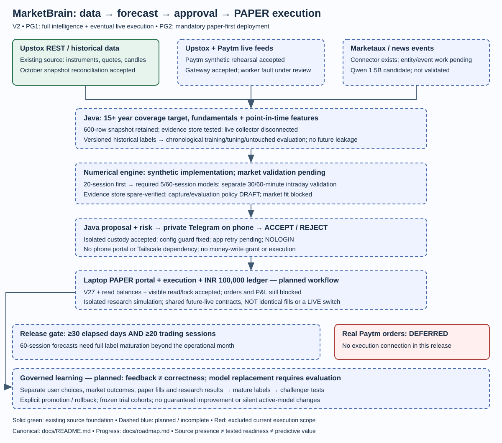

# MarketBrain

**Current E232, 2026-11-05:** Native capture completed in **13.116s**, four sources match `d372adc`, and all three installed helper hashes match their manifest. Three selected event queries returned no matches; administrator curl version succeeded. Both executable metadata rows failed with `CommandNotFoundException`, so the success label did not establish complete collection. [Corrected read-only collection](docs/paytm-native-failure.md) explicitly loads inbox Windows modules, records the metadata stage and rejects missing fields; 117 local assertions include actual PS7-to-PS5 metadata checks with discovery disabled. Worker remains stopped; original native error5 cause unconfirmed. Groups **100/100/40/0/0/0, 12/30 (40%), no increase**; session testing remains on hold.

**Historical E231, 2026-11-05:** Worker inspection completed in **3.16s**; all five source hashes match `2ce584c`. The E228 worker later stopped at a native Windows **Access denied (5)** exception during the observation loop, after 1387.3s recorded uptime. Source line77 points to the curl health-check wrapper; the exact denied native operation is not captured. Task enabled/Ready/result1, process absent, no advancing heartbeat, no session checkpoint. [Next: bounded native/event evidence](docs/paytm-native-failure.md), one read-only report; no marker reset, ACL change or gateway restart. Session testing stays on hold. Accepted groups remain **100/100/40/0/0/0, 12/30 (40%), no increase**; current health is blocked.

**Historical E230, 2026-11-05:** The session baseline stopped after **0.383s** at `STARTUP_WORKER_FAILURE_PRESENT`; all seven source hashes match `dc1ea47`. A saved worker-failure marker blocks the next stage, but the report omitted its contents, so the cause and current worker health are unknown. No session baseline, task/power change or application/account check was completed. [Next: read-only worker inspection](docs/paytm-gateway-session.md#current-handoff-read-the-saved-worker-failure), one JSON; do not sign out, shut down, clear markers or retry the baseline. The collector now includes bounded worker diagnostics automatically for worker failures. E228 network acceptance remains valid at its recorded scope; groups **100/100/40/0/0/0, 12/30 (40%), no increase**. Account/lock flags in this failed run mean unverified, not a proven balance change.

**Historical E228, 2026-11-05:** Network interruption/recovery accepted in **84.761s**; all 11 source hashes match `5ba324a`. Actual replacement SSH denial produced advancing BACKOFF; the same worker reconnected on attempt 3 (23s recorded outage). Both temporary rules/tasks were removed; 3/3 application route checks, no automatic rearm, final application/writer locks and unchanged INR100000 account passed. **G3.1 closes: groups 100/100/40/0/0/0, 12/30 checkpoints (40%, +3.33 percentage points).** This measures the bounded Paytm plan at capture, not whole-project completion or current uptime. Do not rerun recovery/network. [Next: sign-out and full shutdown/startup](docs/paytm-gateway-session.md), one report across three phases; runtime acceptance remains pending. Login, quotes, remaining security/health checks and Telegram review stay open. Root HTTP503 remains transport-only evidence.

**Historical E227, 2026-11-05:** The 5.083s run matched the reviewed receipt hash, then rejected its contents. Root cause reproduced: the checkpoint writer's unqualified path resolved to the helper's input Path and overwrote that receipt. Script-scoped output/timer/report binding fixes this; regression now combines the real reader, validator and writer. [Next: same exact-state recovery using the original byte-pinned repository snapshot](docs/paytm-gateway-network.md), with no manual file restoration. All 11 sources match ea69e3e; no recovery/firewall mutation occurred, saved failure is unchanged, account preserved and application/writer locked. Gateway remains blocked/stopped/disabled. Groups **100/100/20/0/0/0, 11/30 (36.7%), no increase**.

**Historical E222/E223, 2026-11-04:** Cancellation and recovery accepted in 51.253s; all 11 source hashes match bdc162a. Both processes exited and the listener disappeared in 1.529s. A 10.785s quiet interval, fresh healthy worker, 3/3 application checks, unchanged INR 100000 account and final application/writer locks passed. **G3.3 closes: groups 100/100/20/0/0/0, 11/30 checkpoints (36.7%, +3.33 percentage points).** This measures accepted evidence at capture, not continuous health or whole-project completion. Next: [one guarded network-interruption/recovery batch](docs/paytm-gateway-network.md), with a disabled-rule cleanup rehearsal before the real outage. Engineering is prepared; spare acceptance is pending. Do not rerun cancellation/recovery. HTTP 503 remains transport-only evidence; login, quotes and orders remain pending. The original overwritten worker failure remains unknown.

**Historical E221, 2026-11-04:** Recovery archived the evidence and updated the runner/manifest successfully, but the controller read the first heartbeat too early (FileNotFoundException,20.68s). Eleven source hashes verified. A later sample shows a fresh CONNECTING worker with identity/signing passed; TLS/cancellation not established. Cleanup verified STOP/task disable, unchanged INR100000 account and locked application. Bounded startup waiting is corrected; [resume the completed recovery](docs/paytm-gateway-cancellation.md#current-handoff-resume-the-completed-recovery) verifies existing archives/installation and starts the exact task once before cancellation. No reinstall or marker reset. Accepted groups100/100/0/0/0/0,10/30 (33.3%); current gateway deliberately stopped. Earlier recovery command is superseded.

**Historical E220, 2026-11-04:** Inspection succeeded in3.802s; all eight source hashes verified against c1718eb. Worker exited; task result1; the failure latch says TRANSPORT_PREVIOUS_FAILURE_REVIEW_REQUIRED. The old runner overwrote the original cause during a later launch, so that cause remains unknown. First-cause preservation is corrected; [one reviewed recovery plus cancellation batch](docs/paytm-gateway-cancellation.md#current-handoff-recover-once-and-test-cancellation) archives exact evidence, patches only the runner/manifest, makes one fresh start and continues only if healthy. Runtime recovery remains pending. Accepted groups **100/100/0/0/0/0**,10/30 checkpoints (33.3%); current gateway health blocked. This supersedes the earlier InspectOnly handoff.

**Historical E219, 2026-11-04:** The read-only inspection failed after4.489s because the diagnostic reader accessed optional JSON properties under production StrictMode. Reproduced with actual imports and corrected throughout the reader; eight source hashes verified. [Pull and retry InspectOnly](docs/paytm-gateway-cancellation.md#current-handoff-inspect-the-saved-worker-failure), one JSON. Original worker failure/current health remain unknown. Accepted groups **100/100/0/0/0/0** unchanged; cancellation remains on hold.

**Historical E218, 2026-11-04:** Cancellation stopped before changes after3.145s: a saved worker failure marker exists, but its contents were omitted. Seven source hashes verified. Underlying cause/current worker health are unknown. [Next: read-only worker failure capture](docs/paytm-gateway-cancellation.md#current-handoff-inspect-the-saved-worker-failure) using `-InspectOnly`, one JSON; do not reset markers or rerun cancellation yet. Accepted groups **100/100/0/0/0/0** remain unchanged; G3 is blocked pending diagnosis.

**Historical E216/E217, 2026-11-03:** Windows restart accepted in14.623s: new background worker, application TLS route, preserved INR100000 account and final locked application/writer. Five source hashes verified. G2.4 closes; groups **100/100/0/0/0/0**,10/30 accepted checkpoints (33.33% of this bounded plan). [Next: task cancellation and application recovery](docs/paytm-gateway-cancellation.md), one combined batch with orphan/listener cleanup, failure locking and explicit restart without automatic rearm. No reinstall, reboot, key import or VPS change. Remaining G3 and Paytm login/quotes still pending; HTTP503 is transport-only evidence.

**Historical E215, 2026-11-03:** The after-restart report shows a new session-0 worker running with transport ready. Verification stopped after 24.798s because an unsupported 15-second task/process timestamp comparison rejected a 31.352325-second difference. Five source hashes match the reviewed CRLF checkout. The corrected collector validates both timestamps within the new boot window and records their difference; 94 local assertions pass. [Retry After only](docs/paytm-gateway-windows-restart.md#retry-this-interrupted-after-phase): preserve the baseline, no reboot or reinstall. Application/account checks were not reached. Groups remain **100/80/0/0/0/0**, 9/30 accepted checkpoints; full startup acceptance is pending.

**Historical E213/E214, 2026-11-03:** Managed transport accepted in64.115s: all4 application-route checks, duplicate start, deliberate disable, child reconnect and persistent STOP pass; account remains INR100000 and application/writer finish locked. Seven source hashes verified. G2.5 closes: groups **100/80/0/0/0/0**,9/30 checkpoints. [Next: before/after Windows restart verification](docs/paytm-gateway-windows-restart.md),66 local assertions, one report. No installer/key/VPS rerun. Actual Windows startup, remaining G3 recovery/security cases, login and quotes remain pending; HTTP503 is TLS-route evidence only.

**Historical E212, 2026-11-03:** [Managed transport retry](docs/paytm-managed-windows-transport.md) corrects application discovery. Run6fa5d4c881224b6d8dd61a775123fb2b stopped after7.907s before backup/upgrade; the existing supervisor remained LOCKED. Seven source hashes match378a53b. The old report cannot distinguish no running container from multiple candidates. New lookup matches the exact Compose workspace and records stopped/paused/restarting/duplicate states without secrets or automatic restart.25 assertions/11 discovery scenarios and10 deployment regressions pass. Confirm the existing app is running, pull and retry the same batch. Groups100/60/0/0/0/0 unchanged; no VPS/account/key rerun.

**Historical E211, 2026-11-03:** [Managed Windows transport and application-route batch](docs/paytm-managed-windows-transport.md) is implemented and locally verified: 230 assertions covering adapters, native Windows processes/listeners/curl, restricted-policy bootstrap, upgrade workflow and regressions. Reuses the accepted account, task, agent key, VPS and existing application. One spare run combines connection, TLS/denials, duplicate start, disable, child recovery, persistent STOP and route/account checks. No rebuild or VPS reinstall. Spare acceptance and actual boot/logoff remain pending; groups **100/60/0/0/0/0** are unchanged. Earlier handoffs below are historical.

**Historical E210, 2026-11-02:** [Managed VPS lifecycle accepted](docs/evidence/paytm-managed-proxy-accepted-20261102.json). Original valid report proves a10-second pass;46.141-second recovery confirms running/boot-enabled loopback proxy, matching PID/marker and no guard timers. Earlier pasted JSON was corrupted; installation was not repeated. No VPS rerun or further recovery is needed. Next is Windows supervisor transport and effective application-route integration. This VPS substage is100%; full groups remain100/60/0/0/0/0 until their remaining checkpoint requirements pass. Earlier install/recovery instructions below are historical.

**Historical E209, 2026-11-02:** Managed-proxy collection failed at JSON decoding after104.128s; VPS outcome is unconfirmed because the original report was not retained. Windows was LOCKED before the remote step. **Do not rerun installation.** [Recover the saved VPS report and current state](docs/paytm-managed-report-recovery.md) without service changes. Collector now preserves malformed report evidence. Accepted groups remain100/60/0/0/0/0; earlier installation handoffs are on hold.

**Historical E207/E208, 2026-11-02:** Locked supervisor recovery accepted in **36.582 seconds**: background signing, same-process duplicate start, persistent STOP and fresh locked restart passed; ten source hashes verified. Do not rerun recovery or import keys. Next: [managed VPS proxy lifecycle](docs/paytm-managed-proxy.md), combining crash recovery, durable disable, TLS and denial checks while Windows stays locked. Runtime installation is pending; accepted groups remain **100/60/0/0/0/0**. Production Windows transport and actual boot/logoff remain open. Earlier handoffs below are historical.

**Historical E206, 2026-11-02:** [Recover the retained supervisor task](docs/paytm-supervisor-installation.md). Installation prerequisites and registration passed, but task exit1 preceded any heartbeat. File-based helper loading fails under Restricted policy in local reproduction; the original report omitted its exact startup exception. Corrected inline loading, early diagnostics and scoped runner-only recovery are ready;171 local assertions pass. Do not reinstall, recreate the account or reimport keys. Accepted groups remain **100/60/0/0/0/0**.

**Historical E205, 2026-11-02:** [Locked supervisor/startup installation](docs/paytm-supervisor-installation.md) is ready for the spare laptop. One batch checks actual background heartbeat, duplicate start, persistent STOP and locked restart. Local 48 host checks plus 79 gateway regressions pass. Production transport adapters, VPS lifecycle and cold-boot acceptance remain pending. E204 signing remains accepted; do not rerun repair or key import. Accepted groups remain **100/60/0/0/0/0**.

**Current E204, 2026-11-02:** [Batch-logon correction and background signing accepted](docs/evidence/paytm-scheduled-signing-accepted-20261102.json). Total11.675s/worker1.979s; exact non-admin session0,2/2 signatures, task exit0 and temporary task removed. Other policy assignments preserved; no key/password/network/order changes. **Do not rerun repair.** Next: production supervisor and scheduled startup. This G2.4 prerequisite is complete; full group checkpoints remain **100/60/0/0/0/0**.

**Current E197, 2026-10-27:** Windows scanner compatibility defect identified. [Corrected key-custody handoff](docs/paytm-gateway-key-custody.md) accepts the VPS public key only after matching the existing fingerprint; normal SSH authentication remains required. No account reset, server reconfiguration or repeat diagnostic. Groups100/40/0/0/0/0; runtime custody pending.

**Current E196, 2026-10-27:** key import stopped before staging at the VPS public host-key scan. [Credential-free diagnostic is next](docs/paytm-gateway-key-custody.md); native failure evidence is now retained. No account reset or key regeneration. Groups100/40/0/0/0/0 unchanged. Earlier import handoff below is paused pending diagnostic review.

**Current E195, 2026-10-26:** encrypted gateway OpenSSH export owner-verified; [controlled key-custody batch ready](docs/paytm-gateway-key-custody.md). Exact-account import/revoke/reload, pinned authentication and fresh-process signing; one private-entry window and one shareable JSON. No task/tunnel/proxy/broker activation. Local checks112+97 and account regression320 pass; real import pending. Accepted groups100/40/0/0/0/0 unchanged. This supersedes earlier format-confirmation and account-run instructions below.

**Current E194, 2026-10-26: gateway account recovery ACCEPTED.** Eight stages and the real non-admin login/storage/empty-agent probe passed; old folder preserved, shared agent unchanged, three source hashes verified. **G1=100%, G2=40%, G3–G6=0%.** Do not rerun account recovery. [Next: protected gateway-key custody](docs/paytm-gateway-key-custody.md); confirm encrypted PPK versus encrypted OpenSSH format before the import handoff. Earlier commands below are historical and superseded. No key, task, tunnel or broker activation yet.

**Current E192/E193, 2026-10-26:** reviewed inventory confirms the deleted account, retained old-SID storage, empty work folder and Running/Automatic agent. **[Run controlled Recover](docs/paytm-gateway-account.md)**: preserve the old folder, create a new restricted identity/storage and verify it in one batch; no shared-agent configuration change.320 account assertions/26 mocked workflows,29 repair and37 inventory checks pass. Earlier handoffs below are historical and superseded. Accepted percentages remain100/20/0/0/0/0; real recovery/probe evidence pending.

**Current E189/E190, 2026-10-26:** account/storage/agent provisioning succeeded, but the verification launcher exceeded Windows' alternate-user command-line limit. Corrected to a short bootstrap/private stdin, verified236 assertions/17 mocked workflows and native transport cases. **[Run Verify only with the existing password](docs/paytm-gateway-account.md); do not repeat Apply/reset/delete.** Accepted group percentages remain100/20/0/0/0/0 pending the final account probe. Older handoffs below are historical.

**Current E187/E188, 2026-10-24:** account setup stopped before creation at password confirmation; administrator/service checks passed. [Corrected next-login handoff](docs/paytm-gateway-account.md) distinguishes short/mismatched input and allows three private attempts, verified by199 local assertions/16 mocked workflows. No cleanup or maintenance rerun. Accepted group percentages remain **100/20/0/0/0/0**; spare account acceptance is still pending. Older next-step entries below are historical.

**Current E185/E186, 2026-10-23:** spare gateway foundation accepted in 2.335s (79 checks, 12 negative cases, 31 settings). Next: [restricted Windows account/agent setup](docs/paytm-gateway-account.md), explicit local consent and one report; no VPS, key import or gateway activation. [Fixed progress checklist](docs/paytm-readiness-progress.md): G1 **100%**, G2 **20%**, G3–G6 **0%**. Publish group percentages after every evidence review; an accepted account result would move G2 to40%. Do not repeat foundation or maintenance.

**Current E183/E184, 2026-10-23:** VPS reboot/postchecks accepted; maintenance is complete. Do not repeat updates or reboot. Next: [unattended gateway foundation bundle](docs/paytm-gateway-foundation.md), one PowerShell-only report covering recovery rules, owned-process cleanup and installed SSH configuration. No VPS connection, credentials or service/task installation. Provisioning and real recovery remain pending; login/quotes/trades stay disabled. Older next-step notes below are historical.

**Current E181/E182,2026-10-23:** Before stopped on an incorrect script assumption: original gateway is designed `static`, not `disabled`. [Corrected maintenance handoff](docs/paytm-maintenance-completion.md) captures actual state/exit/references and retains all reboot guards. Pull, run fresh Before, then confirmed reboot/After only if clear. No package reinstall or gateway configuration change; prior failed report is not reboot approval.

**Current E179/E180,2026-10-23:** scanner installation/capture accepted (six packages,35.83s collection). Six stale services/four sessions need disposition. Next [one confirmed VPS reboot and post-boot verification](docs/paytm-maintenance-completion.md), no reinstall; independent VNC recovery required. VM microcode is explicitly unassessed/provider-managed only after VM detection. Maintenance remains open; gateway/login/trades are not activated. Earlier next-step notes are historical.

**Current E177/E178,2026-10-23:** six-package scanner plan accepted51.727s, no upgrades/removals/findings. Next [controlled scanner install plus immediate restart scan](docs/paytm-scanner-install.md), explicit confirmation, one JSON and collect-only recovery. No replay of completed70-package updates, reboot, gateway activation or trades. Earlier next-step notes are historical.

**Current E175/E176,2026-10-23:** restart collection succeeded33.811s; targets/health passed, but scanner unavailable, so restart needs remain unassessed. Next [read-only scanner dependency preview](docs/paytm-scanner-plan.md), one JSON. No installation/reboot/activation; completed updates must not be repeated. Earlier next-step notes are historical.

**Current E173/E174, 2026-10-23:** reviewed VPS updates accepted (70 targets, 159.754s, postchecks and owner-confirmed fresh login). Do not repeat installation or Collect; both PuTTY sessions stayed connected. Next [read-only restart review](docs/paytm-restart-review.md), one JSON, no rebuild/restart/reboot or Paytm activation. Earlier next-step commands below are historical.

**Current E172,2026-10-23:** update stopped before installation; follow-up identifies only a newer tzdata candidate. [Reviewed r2 retry](docs/paytm-maintenance-update.md) preserves original staging, requires stopped/no-install evidence and rechecks the backup. Three original JSON inputs; one output. No automatic reboot/gateway/broker activation. Earlier next-step commands are superseded.

**Current E170/E171,2026-10-23:** private VPS backup accepted in95.89s; source comparison passed, package state unchanged. [Next reviewed package update and verification](docs/paytm-maintenance-update.md) is a real-change handoff with explicit owner confirmation, independent job and collect-only recovery. No automatic reboot, gateway activation or broker access. Same-VPS backup is not full rollback; earlier next-step notes are historical.

**Current E168/E169,2026-10-23:** maintenance preflight accepted; independent console login owner-confirmed. Next [private VPS backup](docs/paytm-maintenance-backup.md), one shareable JSON, archive stays root-only on VPS. No updates/restart/activation; no plan rerun. Earlier next-step notes are historical.

**Current E166/E167,2026-10-23:** relative clock snapshot accepted10/10, no rerun needed. Next [consolidated maintenance preflight](docs/paytm-maintenance-plan.md): one read-only report, no updates/reboot/activation. Six remaining acceptance batches documented; not six guaranteed executions. Older next-step entries below are historical.

Personal Indian-equity research and a planned **INR 100,000 paper-trading portal**. Live market data is allowed under reviewed provider access; real broker order execution is outside the current release.

The two parent goals are a full trading-intelligence platform and its mandatory paper-first deployment: 15+ year history target, technical/fundamental/quantitative/news analysis, required 5/20/60-session forecasts plus separate intraday horizons, Telegram ACCEPT/REJECT, controlled feedback learning and eventually separately authorized Paytm execution. These are target capabilities, not a claim of implementation. See the canonical V2 baseline below.

## Start here

**Current E164/E165:** owner manually corrected Windows; reports<5s VPS difference. Next [Windows/VPS/main-Java clock snapshot](docs/paytm-clock-snapshot.md), five bounded read-only sample pairs, no rebuild. Original admin key temporarily in Pageant; no gateway start, clock changes or broker access. Relative measurement and ongoing synchronization remain pending.

**Current E162/E163:** VPS index refresh accepted (5s;70 upgrade candidates). Elevation passed, but Windows Time service access was denied before resync. Next: [Windows-only read-only access diagnosis](docs/paytm-windows-time-access.md); no PuTTY, VPS refresh retry or service-permission reset. Unattended activation/login remain pending.

**Current E161:** the clock/index follow-up stopped before changes because PowerShell was not elevated. The [updated handoff](docs/paytm-operations-followup.md) now requests Windows UAC and opens a new administrator PowerShell 7 window. Guard and manual confirmation preserved; actual follow-up remains pending, no route retest or broker activation.

**Current E159/E160, 2026-10-22:** main Spring route remains accepted **8/8**. Operations snapshot captured with findings in **134.148 seconds**: expected IP/configuration/stopped state, clock disagreement and cached updates; proxy-version UNKNOWN traced to our wrong-package query. Next: [Windows clock and VPS index follow-up](docs/paytm-operations-followup.md), locally verified. VPS clock untouched; no upgrades, reboot or broker activation. Unattended gateway comes before login; older handoffs below are historical.

**Latest E138, 2026-10-15:** the first application handoff stopped safely before build/deployment because the configuration guard rejected field presence rather than effective overrides. The guard now accepts null/default values and reports only the name of a rejected field; 314 offline assertions across 14 mocked runner scenarios pass. The exact triggering field in the old spare report was not captured. Pull and retry the [guarded application handoff](docs/paper-runtime-application-handoff.md), not the already accepted isolated test. Package60%, roadmap12.4%; no new runtime completion credit.

**Latest E136/E137, 2026-10-15:** isolated custody/restart verification is accepted at100%; do not rerun it. The next [guarded application handoff](docs/paper-runtime-application-handoff.md) is locally verified with236 assertions. It rebuilds/recreates the service, tests the existing protected credential in memory, verifies locked restart and finishes locked with PostgreSQL NOLOGIN. No publication, order, reservation or fill. Spare deployment/acceptance pending; full roadmap12.4%. Older handoffs below are historical.

**Latest E135, 2026-10-15:** the isolated spare test exposed an invalid dummy Telegram pairing code. The fixture is corrected, with a regression test using its exact configuration; real validation rules are unchanged. Pull the correction and rerun only the [single isolated credential/policy bundle](docs/paper-runtime-credential-handoff.md). No real credential, application rebuild/restart, database or Telegram call. Package60%; spare verification remains pending, with no new completion credit for this repair. E133 authentication remains accepted; older handoffs below are historical. Actual publication/activation and trading remain off.

Current handoff, 2026-10-14: [bounded writer authentication and revocation](docs/paper-writer-authentication.md). Credential staging is accepted: five successful database stages, 11 source matches, 24.077 seconds, both roles NOLOGIN. Next: one explicitly confirmed temporary login test through the existing application container, correct/wrong-secret checks, committed NOLOGIN restoration, session cleanup and recovery; one shareable JSON. No application rebuild, Telegram activation, account writes or orders. Do not repeat accepted installation, HBA or credential staging. Phone approvals use Telegram; Tailscale remains unchanged. October feature reconciliation is closed (E84).

[Canonical documentation](docs/README.md) is the single entry point for scope, goals, evidence, timelines and daily progress.

- [Roadmap and completion dashboard](docs/roadmap.md)
- [System and paper-portal design](docs/system-design.md)
- [Evidence register and verification procedure](docs/evidence-register.md)
- [Daily progress and decision log](docs/daily-progress.md)

## Current state

The Java service contains Upstox REST integration, historical/daily collection, technical snapshots, prototype outcome datasets, model-evaluation tools, and notification foundations. The React paper portal reads the stored account/ledger; operational orders, holdings and P&L remain pending. A trained numerical predictor, live streaming pipeline and complete application paper-order lifecycle are not yet implemented. Source presence does not prove spare-laptop runtime readiness.

Development and offline verification take place here; model inference and deployment take place on the spare laptop. Credentials stay in ignored local configuration. Do not enable live execution or use archived deployment commands as current instructions.

The [ten-feature numerical engineering bundle](docs/numerical-ten-feature-engineering.md) passed 32/32 spare checks; this engineering checkpoint is complete. It is not a trained market predictor and does not lift the source/evaluation gates. The owner-approved [two-track preparation plan](docs/numerical-research-scope-decision.md) separates restricted retrospective research from prospective validation. No repeat bundle, service rebuild or LLM run is requested.

The 2026-09-18 documentation reset changes documentation only. Earlier plans and experiments remain in [the explicitly superseded archive](docs/archive/2026-09-18/INDEX.md). No application build or deployment is required to receive this reset.
