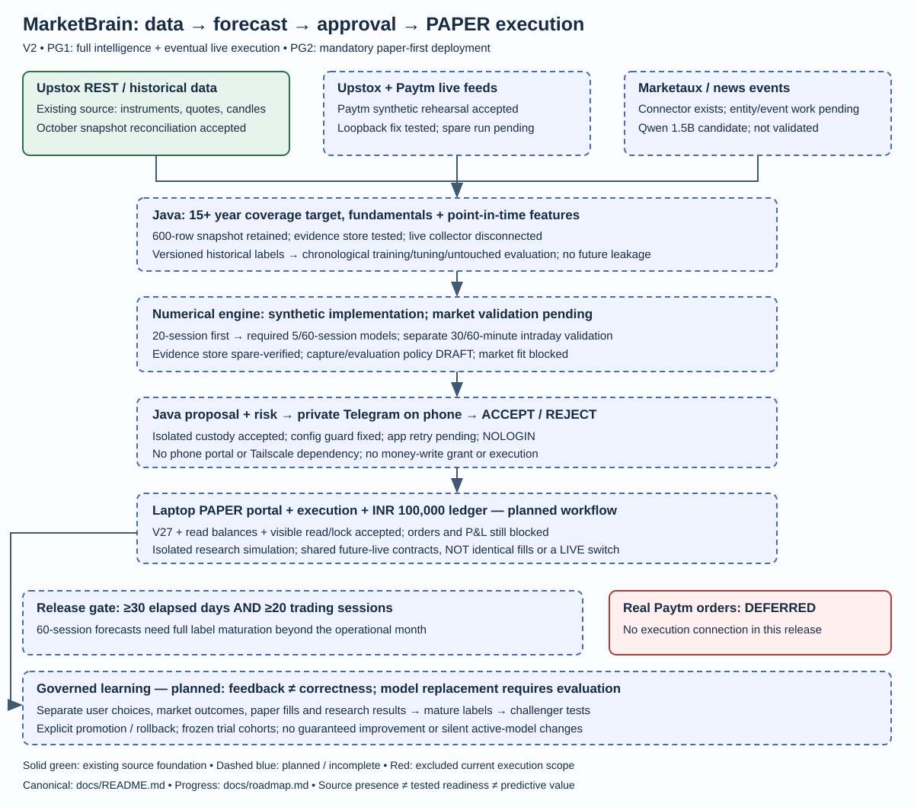

# MarketBrain

**Current E177/E178,2026-10-23:** six-package scanner plan accepted51.727s, no upgrades/removals/findings. Next [controlled scanner install plus immediate restart scan](docs/paytm-scanner-install.md), explicit confirmation, one JSON and collect-only recovery. No replay of completed70-package updates, reboot, gateway activation or trades. Earlier next-step notes are historical.

**Current E175/E176,2026-10-23:** restart collection succeeded33.811s; targets/health passed, but scanner unavailable, so restart needs remain unassessed. Next [read-only scanner dependency preview](docs/paytm-scanner-plan.md), one JSON. No installation/reboot/activation; completed updates must not be repeated. Earlier next-step notes are historical.

**Current E173/E174, 2026-10-23:** reviewed VPS updates accepted (70 targets, 159.754s, postchecks and owner-confirmed fresh login). Do not repeat installation or Collect; both PuTTY sessions stayed connected. Next [read-only restart review](docs/paytm-restart-review.md), one JSON, no rebuild/restart/reboot or Paytm activation. Earlier next-step commands below are historical.

**Current E172,2026-10-23:** update stopped before installation; follow-up identifies only a newer tzdata candidate. [Reviewed r2 retry](docs/paytm-maintenance-update.md) preserves original staging, requires stopped/no-install evidence and rechecks the backup. Three original JSON inputs; one output. No automatic reboot/gateway/broker activation. Earlier next-step commands are superseded.

**Current E170/E171,2026-10-23:** private VPS backup accepted in95.89s; source comparison passed, package state unchanged. [Next reviewed package update and verification](docs/paytm-maintenance-update.md) is a real-change handoff with explicit owner confirmation, independent job and collect-only recovery. No automatic reboot, gateway activation or broker access. Same-VPS backup is not full rollback; earlier next-step notes are historical.

**Current E168/E169,2026-10-23:** maintenance preflight accepted; independent console login owner-confirmed. Next [private VPS backup](docs/paytm-maintenance-backup.md), one shareable JSON, archive stays root-only on VPS. No updates/restart/activation; no plan rerun. Earlier next-step notes are historical.

**Current E166/E167,2026-10-23:** relative clock snapshot accepted10/10, no rerun needed. Next [consolidated maintenance preflight](docs/paytm-maintenance-plan.md): one read-only report, no updates/reboot/activation. Six remaining acceptance batches documented; not six guaranteed executions. Older next-step entries below are historical.

Personal Indian-equity research and a planned **INR 100,000 paper-trading portal**. Live market data is allowed under reviewed provider access; real broker order execution is outside the current release.

The two parent goals are a full trading-intelligence platform and its mandatory paper-first deployment: 15+ year history target, technical/fundamental/quantitative/news analysis, required 5/20/60-session forecasts plus separate intraday horizons, Telegram ACCEPT/REJECT, controlled feedback learning and eventually separately authorized Paytm execution. These are target capabilities, not a claim of implementation. See the canonical V2 baseline below.

## Start here

**Current E164/E165:** owner manually corrected Windows; reports<5s VPS difference. Next [Windows/VPS/main-Java clock snapshot](docs/paytm-clock-snapshot.md), five bounded read-only sample pairs, no rebuild. Original admin key temporarily in Pageant; no gateway start, clock changes or broker access. Relative measurement and ongoing synchronization remain pending.

**Current E162/E163:** VPS index refresh accepted (5s;70 upgrade candidates). Elevation passed, but Windows Time service access was denied before resync. Next: [Windows-only read-only access diagnosis](docs/paytm-windows-time-access.md); no PuTTY, VPS refresh retry or service-permission reset. Unattended activation/login remain pending.

**Current E161:** the clock/index follow-up stopped before changes because PowerShell was not elevated. The [updated handoff](docs/paytm-operations-followup.md) now requests Windows UAC and opens a new administrator PowerShell 7 window. Guard and manual confirmation preserved; actual follow-up remains pending, no route retest or broker activation.

**Current E159/E160, 2026-10-22:** main Spring route remains accepted **8/8**. Operations snapshot captured with findings in **134.148 seconds**: expected IP/configuration/stopped state, clock disagreement and cached updates; proxy-version UNKNOWN traced to our wrong-package query. Next: [Windows clock and VPS index follow-up](docs/paytm-operations-followup.md), locally verified. VPS clock untouched; no upgrades, reboot or broker activation. Unattended gateway comes before login; older handoffs below are historical.

**Latest E138, 2026-10-15:** the first application handoff stopped safely before build/deployment because the configuration guard rejected field presence rather than effective overrides. The guard now accepts null/default values and reports only the name of a rejected field; 314 offline assertions across 14 mocked runner scenarios pass. The exact triggering field in the old spare report was not captured. Pull and retry the [guarded application handoff](docs/paper-runtime-application-handoff.md), not the already accepted isolated test. Package60%, roadmap12.4%; no new runtime completion credit.

**Latest E136/E137, 2026-10-15:** isolated custody/restart verification is accepted at100%; do not rerun it. The next [guarded application handoff](docs/paper-runtime-application-handoff.md) is locally verified with236 assertions. It rebuilds/recreates the service, tests the existing protected credential in memory, verifies locked restart and finishes locked with PostgreSQL NOLOGIN. No publication, order, reservation or fill. Spare deployment/acceptance pending; full roadmap12.4%. Older handoffs below are historical.

**Latest E135, 2026-10-15:** the isolated spare test exposed an invalid dummy Telegram pairing code. The fixture is corrected, with a regression test using its exact configuration; real validation rules are unchanged. Pull the correction and rerun only the [single isolated credential/policy bundle](docs/paper-runtime-credential-handoff.md). No real credential, application rebuild/restart, database or Telegram call. Package60%; spare verification remains pending, with no new completion credit for this repair. E133 authentication remains accepted; older handoffs below are historical. Actual publication/activation and trading remain off.

Current handoff, 2026-10-14: [bounded writer authentication and revocation](docs/paper-writer-authentication.md). Credential staging is accepted: five successful database stages, 11 source matches, 24.077 seconds, both roles NOLOGIN. Next: one explicitly confirmed temporary login test through the existing application container, correct/wrong-secret checks, committed NOLOGIN restoration, session cleanup and recovery; one shareable JSON. No application rebuild, Telegram activation, account writes or orders. Do not repeat accepted installation, HBA or credential staging. Phone approvals use Telegram; Tailscale remains unchanged. October feature reconciliation is closed (E84).

[Canonical documentation](docs/README.md) is the single entry point for scope, goals, evidence, timelines and daily progress.

- [Roadmap and completion dashboard](docs/roadmap.md)
- [System and paper-portal design](docs/system-design.md)
- [Evidence register and verification procedure](docs/evidence-register.md)
- [Daily progress and decision log](docs/daily-progress.md)

## Current state

The Java service contains Upstox REST integration, historical/daily collection, technical snapshots, prototype outcome datasets, model-evaluation tools, and notification foundations. The React paper portal reads the stored account/ledger; operational orders, holdings and P&L remain pending. A trained numerical predictor, live streaming pipeline and complete application paper-order lifecycle are not yet implemented. Source presence does not prove spare-laptop runtime readiness.

Development and offline verification take place here; model inference and deployment take place on the spare laptop. Credentials stay in ignored local configuration. Do not enable live execution or use archived deployment commands as current instructions.

The [ten-feature numerical engineering bundle](docs/numerical-ten-feature-engineering.md) passed 32/32 spare checks; this engineering checkpoint is complete. It is not a trained market predictor and does not lift the source/evaluation gates. The owner-approved [two-track preparation plan](docs/numerical-research-scope-decision.md) separates restricted retrospective research from prospective validation. No repeat bundle, service rebuild or LLM run is requested.

The 2026-09-18 documentation reset changes documentation only. Earlier plans and experiments remain in [the explicitly superseded archive](docs/archive/2026-09-18/INDEX.md). No application build or deployment is required to receive this reset.
